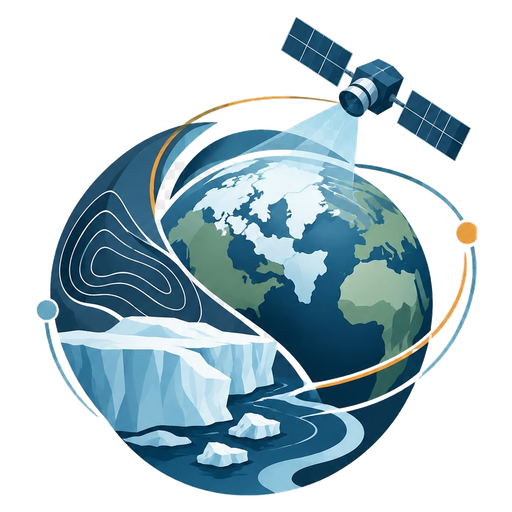
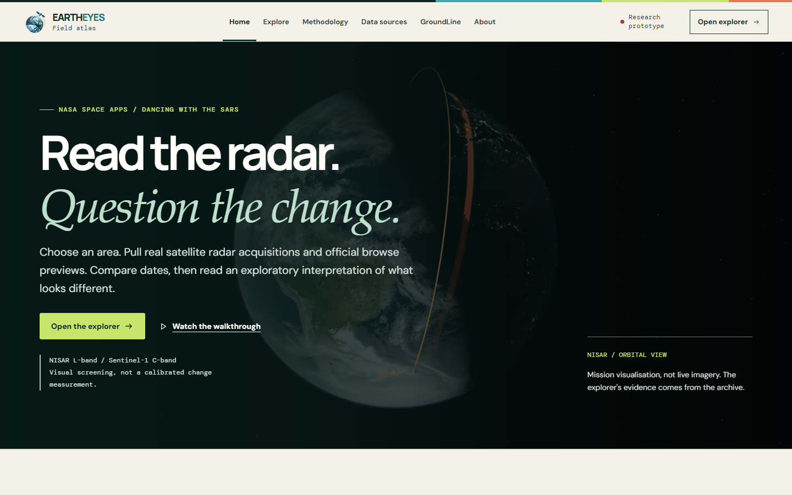
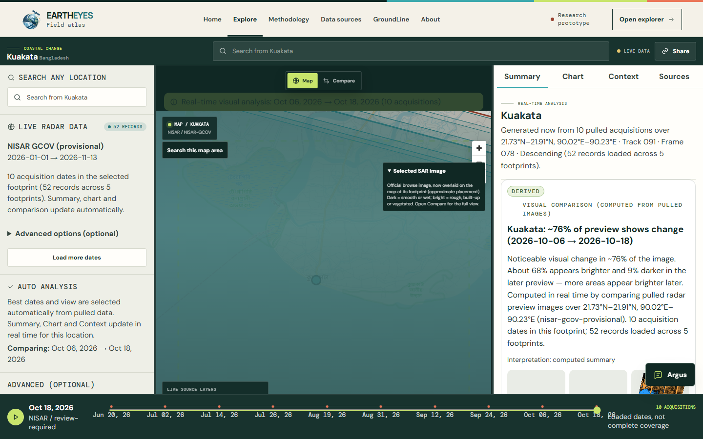
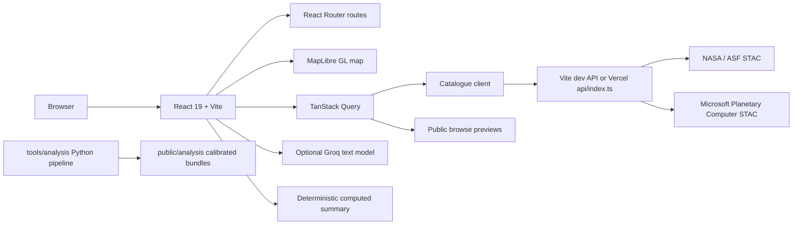

<div align="center">



# EarthEyes

**Read the radar. Question the change.**

A map-first SAR field atlas built for the **NASA Space Apps Challenge 2026** — _Dancing with the SARs_.

[](https://eartheyes.vercel.app)
[](https://www.spaceappschallenge.org/)

[Live app](https://eartheyes.vercel.app) · [Explorer](https://eartheyes.vercel.app/explore) · [Walkthrough](https://www.youtube.com/watch?v=vzeL2bBZ5Sk) · [Methodology](https://eartheyes.vercel.app/methodology) · [Roadmap](TODO.md)

<br />

[](https://react.dev)
[](https://vite.dev)
[](https://www.typescriptlang.org)
[](https://tailwindcss.com)
[](https://vitest.dev)
[](https://playwright.dev)
[](https://eartheyes.vercel.app)
[](https://github.com/Shadman-Samin/EarthEyes_NASASpaceApps/actions/workflows/backend-checks.yml)

</div>



## Table of contents

- [Overview](#overview)
- [Live demo](#live-demo)
- [Why EarthEyes](#why-eartheyes)
- [Feature tour](#feature-tour)
- [Inside the explorer](#inside-the-explorer)
- [How it works](#how-it-works)
- [Tech stack](#tech-stack)
- [Project structure](#project-structure)
- [Run locally](#run-locally)
- [Environment variables](#environment-variables)
- [Scripts](#scripts)
- [Testing and quality](#testing-and-quality)
- [Data sources and scientific boundaries](#data-sources-and-scientific-boundaries)
- [Deployment](#deployment)
- [Worldwide catalogue backend](#worldwide-catalogue-backend)
- [Offline calibrated analysis](#offline-calibrated-analysis)
- [Roadmap and known limits](#roadmap-and-known-limits)
- [Team — EyesofArgus](#team--eyesofargus)
- [About me](#about-me)
- [Acknowledgements](#acknowledgements)

## Overview

EarthEyes is a browser-based field atlas for inspecting synthetic aperture radar (SAR) observations of a place, comparing acquisitions from different dates, and reading an interpretation that keeps its limits visible.

You choose an area on the map. EarthEyes pulls real NASA NISAR GCOV metadata and official browse previews through a live catalogue API, groups observations by footprint, and selects the earliest and latest usable pair. The explorer then shows the comparison, the acquisition timeline, computed preview statistics, and a plain-language summary.

The project is a **research prototype**, not an operational monitoring or warning service. SAR brightness is not a sea-level measurement, a flood forecast, or an ice-velocity product. Every derived claim stays tied to source records, stated uncertainty, and the fact that the interpretation is exploratory.

## Live demo

**https://eartheyes.vercel.app**

| Route | What it shows |
| --- | --- |
| [`/`](https://eartheyes.vercel.app/) | Landing page, walkthrough, and reference investigations |
| [`/explore`](https://eartheyes.vercel.app/explore) | Map-first SAR workspace with comparison and evidence |
| [`/methodology`](https://eartheyes.vercel.app/methodology) | How the comparison and interpretation are computed |
| [`/data-sources`](https://eartheyes.vercel.app/data-sources) | Mission roles, providers, and source boundaries |
| [`/groundline`](https://eartheyes.vercel.app/groundline) | GroundLine warning-governance demonstration |
| [`/about`](https://eartheyes.vercel.app/about) | Project scope and what remains outside it |

## Why EarthEyes

Optical imagery is easy to read but can be blocked by clouds, smoke, or darkness. Radar can observe the surface through those conditions, but a dramatic before-and-after image still leaves hard questions:

- Are these observations from the same footprint?
- Which dates, orbit, and polarization are being compared?
- Is the difference environmental, seasonal, or an artefact of how the previews were made?
- What does the comparison **not** establish?

EarthEyes keeps those questions next to the image. The goal is not to turn every visible difference into a claim, but to help a visitor inspect real source records and build a better question.

## Feature tour

| Capability | What it does |
| --- | --- |
| **Live catalogue** | Searches real NASA/ASF and Microsoft Planetary Computer STAC metadata for any valid bounding box, including polar regions and the antimeridian. |
| **Product switching** | Loads NISAR GCOV (provisional) by default, with an OPERA Sentinel-1 RTC archive option. |
| **Footprint-aware grouping** | Prevents adjacent ground footprints from being compared as if they were before/after observations. |
| **Automatic pairing** | Selects the best footprint and earliest/latest usable acquisition pair from the pulled records. |
| **Five comparison modes** | Swipe, side-by-side, single, difference, and fade. |
| **Evidence drawer** | Summary, chart, and context generated from the loaded records and preview statistics. |
| **Argus** | A contextual guide that answers questions from the current explorer state, with an optional Groq-backed response and a deterministic fallback. |
| **Reference investigations** | Kuakata (Bangladesh), Barishal (Bangladesh), and Jakobshavn Isbrae (Greenland) as starting points, not pre-verified findings. |
| **GroundLine** | A local interface demonstration of analyst review, supporting evidence, and authority approval before any public warning. No messages are sent. |
| **Shareable state** | Share links capture bounds, dates, footprint, and acquisition IDs, with explicit handling when a shared record is outside the loaded pages. |
| **Honest failure states** | Missing imagery, provider failures, and unconfigured APIs stay visible instead of silently substituting demo data. |
| **Accessible by design** | Reduced-motion and low-bandwidth paths, WCAG checks, responsive layouts, and route announcements. |

## Inside the explorer



The `/explore` workspace is a single investigation surface:

1. **Bound the area.** Pan the map and choose **Search this map area**, or enter WGS84 bounds in Controls. Name search offers a short reference list, not a global geocoder.
2. **Pull records.** The catalogue returns acquisition metadata and public browse assets. The explorer groups records by frame and keeps pagination, deduplication, and dateline continuations intact.
3. **Compare.** Switch between swipe, side-by-side, single, difference, and fade views. The selected pair, footprint, and polarization stay visible.
4. **Read the evidence.** The drawer computes brighter/darker pixel shares and an acquisition timeline from the pulled previews. Summary, Chart, and Context update in real time.
5. **Ask Argus.** Argus receives the same loaded acquisitions and computed statistics. It can use an optional Groq text model; otherwise it answers from deterministic data-based logic. It does not inspect images or issue warnings.

All real-time interpretation is **exploratory and uncalibrated**. The calibrated NISAR GCOV bundles under `public/analysis/` remain reproducible for the two flagship investigations, but they are not wired into the live explorer UI.

## How it works



- The frontend is a static React application. During development, a Vite adapter serves the catalogue API on the same origin.
- On Vercel, `api/index.ts` exposes the catalogue through a serverless function, so the production site does not need a separate API base URL.
- On other static hosts, set `VITE_CATALOGUE_API_BASE_URL` to a deployed Cloudflare Worker endpoint. An unconfigured host reports an error rather than returning fixture records.
- The optional AI path only receives facts already present in the explorer. `VITE_` values are embedded in the client bundle and are **public**; use a Worker proxy for any production secret.

## Tech stack

| Layer | Tools |
| --- | --- |
| **UI** | React 19, React Router 7, TypeScript 5.9, Tailwind CSS 4 |
| **Mapping** | MapLibre GL 6 |
| **Components** | Radix UI, cmdk, react-resizable-panels |
| **Data and validation** | TanStack Query 5, Zod 4 |
| **Build** | Vite 8 |
| **API** | Cloudflare Worker runtime, Vercel serverless function, `wrangler` |
| **Optional AI** | Groq text and vision models |
| **Testing** | Vitest 5, Testing Library, MSW, Playwright, axe-core, Lighthouse CI |
| **Component workshop** | Storybook 10 |
| **Offline analysis** | Python tools in `tools/analysis` |
| **Deployment** | Vercel production from `development`; optional Cloudflare Worker |

## Project structure

```text
.
├── api/                     Vercel serverless entry for the catalogue
├── backend/api/             Cloudflare Worker catalogue, tests, and smoke checks
├── docs/                    Backend design notes and README assets
├── e2e/                     Playwright journeys, accessibility, and visual tests
├── public/                  Static assets and calibrated analysis bundles
├── src/
│   ├── app/                 Providers, routed shell, announcements, errors
│   ├── data/                Repository adapters, catalogue client, query hooks
│   ├── domain/              Zod contracts and module registry
│   ├── features/            Map, search, comparison, timeline, evidence, Argus
│   ├── mocks/               Validated fixtures and MSW handlers
│   ├── routes/              Landing, explorer, stories, methodology, sources
│   ├── shared/              UI primitives, formatting, responsive utilities
│   └── styles/              Design tokens and route-specific styles
├── tools/analysis/          Offline NISAR extraction and calibration pipeline
├── vercel.json              SPA rewrites and deployment guards
└── vite.config.ts           Vite, Tailwind, and local catalogue adapter
```

## Run locally

Requires **Node.js 22.12 or newer**.

```sh
npm ci
npm run dev
```

Open the Vite URL and select **Open the explorer**. `npm run dev` serves the frontend and the metadata API together; a second server or Earthdata login is not needed for public metadata and browse images.

The explorer defaults to NISAR GCOV (provisional) from January 2026 to today. Kuakata has a known mid-2026 NISAR coverage window. Use **Advanced options (optional)** in Controls to change the window, switch to the OPERA Sentinel-1 2024 archive, choose a footprint, or change polarization (HV recommended).

Only selected public browse images are fetched, never whole protected satellite rasters. The previews are not calibrated change maps or georeferenced image overlays; the map displays actual acquisition footprints.

## Environment variables

Copy `.env.example` to a gitignored `.env` and set only what you need.

| Variable | Purpose |
| --- | --- |
| `VITE_GROQ_API_KEY` | Optional Groq key. Without it, Argus and Summary use the deterministic fallback. |
| `VITE_GROQ_MODEL` | Optional text model override for Argus. |
| `VITE_GROQ_VISION_MODEL` | Optional vision model for image + facts interpretation. |
| `VITE_CATALOGUE_API_BASE_URL` | Deployed catalogue Worker base for non-Vercel static hosts. |
| `VITE_API_BASE_URL` | Separate full-repository boundary; do not point it at the catalogue-only API. |
| `VITE_BASE_PATH` | Build-time base path when the app is served under a subpath. |

> **Security note:** `VITE_` values are embedded in the client bundle and are public. For a public production deployment, proxy AI calls through a Worker or another server-side boundary.

## Scripts

| Command | What it does |
| --- | --- |
| `npm run dev` | Start Vite and the local catalogue adapter |
| `npm run dev:api` | Start the standalone Cloudflare Worker runtime |
| `npm run build` | Production build |
| `npm run preview` | Preview the production build with the local API adapter |
| `npm run lint` | ESLint |
| `npm run typecheck` | TypeScript with `--noEmit` |
| `npm test` | Run frontend and backend Vitest projects |
| `npm run test:coverage` | Coverage report with configured thresholds |
| `npm run test:e2e` | Playwright journeys and visual checks |
| `npm run test:backend` | Backend Vitest project only |
| `npm run smoke:api` | Live metadata smoke check against a running API |
| `npm run check:api` | Dry-run deployable Worker build |
| `npm run build-storybook` | Static Storybook build |
| `npm run lighthouse` | Lighthouse CI run |

## Testing and quality

```sh
npm run lint
npm run typecheck
npm test
npm run build
npm run build-storybook
npm run test:e2e
npm run lighthouse
```

Playwright covers Chromium, Firefox, a 360 px mobile viewport, WCAG checks, responsive overflow, core explorer journeys, Argus, GroundLine, and visual snapshots. CI repeats lint, typecheck, unit tests, the production build, and a Worker dry-run build for every push to `development`.

## Data sources and scientific boundaries

EarthEyes is built around public metadata and browse assets:

- **NASA / ISRO NISAR** — L-band SAR mission context and provisional GCOV metadata.
- **ASF DAAC** — NISAR and Sentinel-1 archive metadata and public browse references.
- **OPERA Sentinel-1 RTC** — historical C-band archive option for comparison.
- **Microsoft Planetary Computer** — additional STAC metadata index.

Important limits:

- A radar preview is **not** a calibrated measurement, a sea-level record, an ice-velocity product, or a flood forecast.
- Brighter or darker pixels can reflect geometry, surface roughness, moisture, vegetation, or processing choices — not only environmental change.
- NISAR coverage varies by place and date. Empty results are real results, not a cue to substitute demo data.
- GroundLine is a demonstration of governance steps. It does not send SMS or voice messages and cannot bypass analyst review or authority approval.
- The calibrated Kuakata and Jakobshavn bundles are reproducible offline artifacts. They are not the same thing as the live, exploratory explorer output.

Quantitative claims should stay tied to granule IDs, dates, polarization, and stated limitations. NISAR observations must never be presented as direct sea-level measurements, and GLOF candidates must never become public warnings without analyst review and authority approval.

## Deployment

EarthEyes is deployed on **Vercel** at **https://eartheyes.vercel.app**.

- **Production branch:** `development` — the default and only active development branch.
- **Archived branch:** `legacy/main` preserves the original `main` history. It is not deployed.
- **API:** `api/index.ts` serves the catalogue on the same origin as the frontend.
- **Guards:** `vercel.json` disables deployments from `main` and `legacy/main`.

> **Sync checklist:** keep the Vercel project's **Settings → Git → Production Branch** set to
> `development`. The repository default branch is already `development`; that dashboard setting is the
> remaining link between a push and a production release.

The original GitHub Pages workflow has been removed. The live deployment is Vercel; GitHub Pages is not enabled for this repository.

To deploy the catalogue Worker separately:

```sh
npm run check:api
npm run deploy:api
```

Follow [`backend/api/README.md`](backend/api/README.md) for cloud prerequisites and request limits.

## Worldwide catalogue backend

The first backend module lives in `backend/api`: a Cloudflare Worker that searches real NASA/ASF and Microsoft STAC metadata for arbitrary worldwide bounding boxes, including polar regions and the antimeridian. It validates queries and source records, bounds upstream requests, supports pagination and caching, and does not download imagery or manufacture measurements.

```sh
npm run dev:api
npm run test:backend
npm run smoke:api
npm run check:api
```

Run the smoke check while the local API is listening on `http://127.0.0.1:8787`.

See [`backend/api/README.md`](backend/api/README.md) for requests, limits, and cloud deployment prerequisites, and [`docs/backend/worldwide-design.md`](docs/backend/worldwide-design.md) for the modular architecture.

## Offline calibrated analysis

The live explorer interprets pulled data in real time. Separately, calibrated georeferenced bundles for Kuakata and Jakobshavn remain under `public/analysis/<place>/` for reproducibility. They are generated offline by `tools/analysis` from real NISAR GCOV granules; an Earthdata bearer token is required and is never committed.

The pipeline reads only the needed HDF5 windows, computes calibrated dB change, water-area time series, clusters, and a plain-language story for every date pair, then writes Int16 rasters plus a JSON manifest. Each pair names its own delta raster and its own story, so the prose always matches the selected comparison.

```sh
cd tools/analysis
python extract.py --site kuakata-bangladesh
python extract.py --site jakobshavn-glacier
python analyze.py --site kuakata-bangladesh
python analyze.py --site jakobshavn-glacier
```

See [`tools/analysis/README.md`](tools/analysis/README.md) for authentication, ROI, and reproducibility details.

## Roadmap and known limits

Open work is tracked in [`TODO.md`](TODO.md). Current boundaries:

- A public AI deployment still needs a server-side proxy and quota controls.
- The catalogue Worker has not been deployed to a public Cloudflare account.
- Calibrated raster processing and scientific measurements remain a separate offline path.
- GroundLine is an interface demonstration, not an operational warning system.
- Reference place search is a small curated list, not a worldwide geocoder.

The product deliberately keeps failures, missing coverage, and uncalibrated outputs visible. That is part of the design, not a placeholder for hidden automation.

## Team — EyesofArgus

**Daffodil International University**

| Member | Role |
| --- | --- |
| **Shadman Samin** | Team Lead |
| **Nusrat Jahan Neha** | Researcher & Content Writer |
| **Muhammad Nayeem** | Software & AI Developer |
| **Md. Fahim Abrar Swapnil** | Geospatial Data Analyst |
| **Jannatul Ferdous Mim** | Designer |

## About me

I'm **Shadman Samin**, Team Lead of **EyesofArgus** at Daffodil International University. I built EarthEyes to make real SAR observations inspectable without hiding uncertainty, missing coverage, or the difference between a visual comparison and a calibrated measurement.

- **Live app:** https://eartheyes.vercel.app
- **GitHub:** https://github.com/Shadman-Samin
- **Project repository:** https://github.com/Shadman-Samin/EarthEyes_NASASpaceApps

If you are exploring SAR, working on a similar Earth-observation workflow, or want to challenge the methodology, the code and the limitations are both open for review.

## Acknowledgements

Built for the **NASA Space Apps Challenge 2026** challenge, _Dancing with the SARs_. Thanks to NASA and ISRO for the NISAR mission, ASF DAAC for SAR archive access, the OPERA team for Sentinel-1 RTC products, and Microsoft Planetary Computer for an additional public STAC index.

EarthEyes is an independent research prototype. It is not affiliated with or endorsed by NASA, ISRO, ASF, ESA, or Microsoft.
